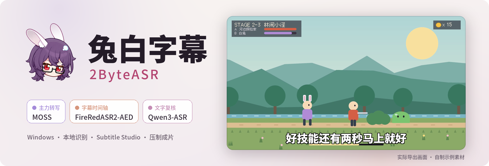
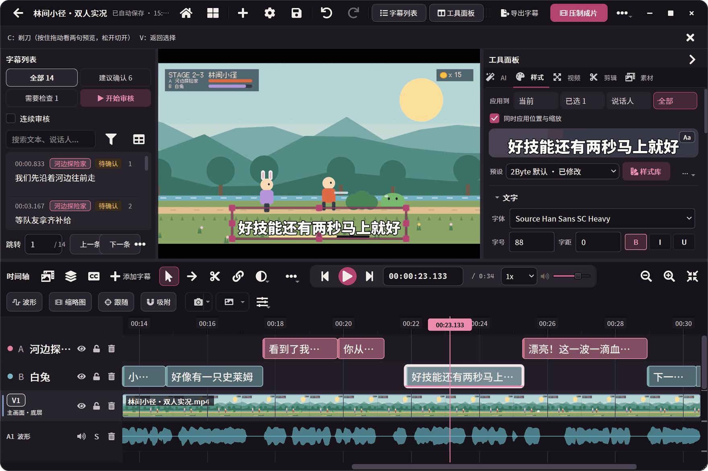
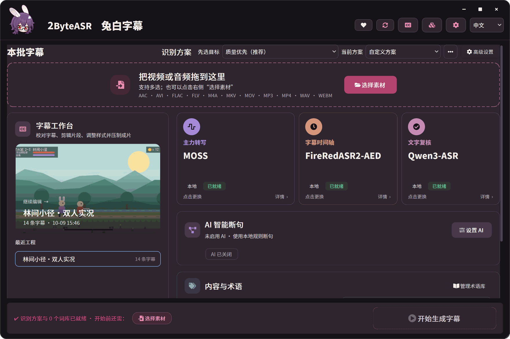
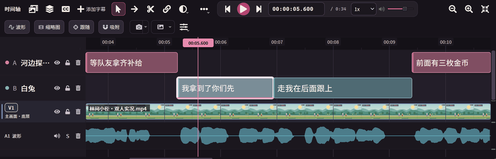
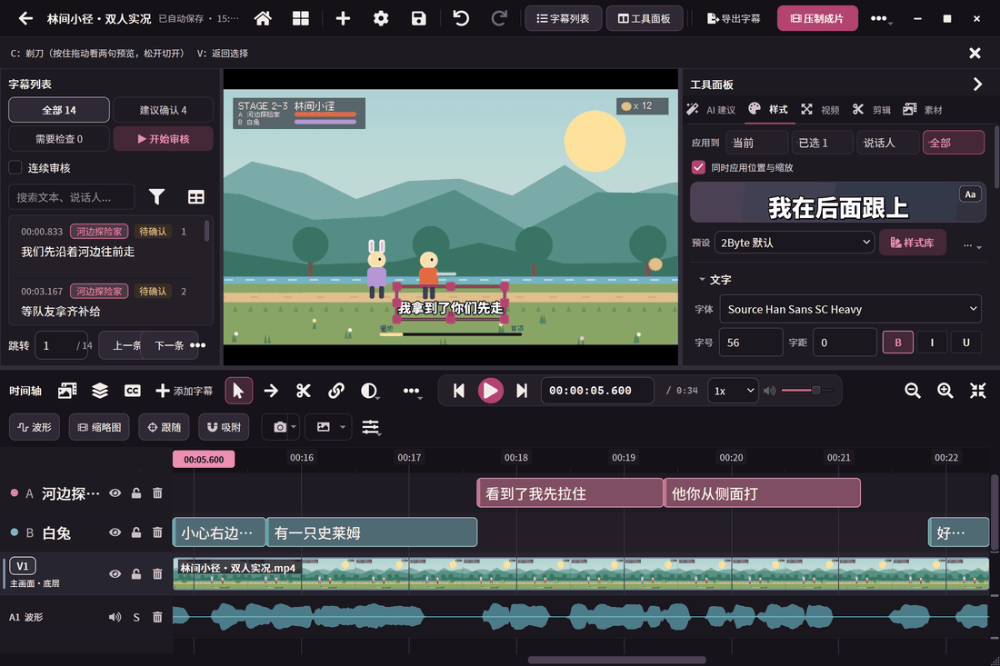
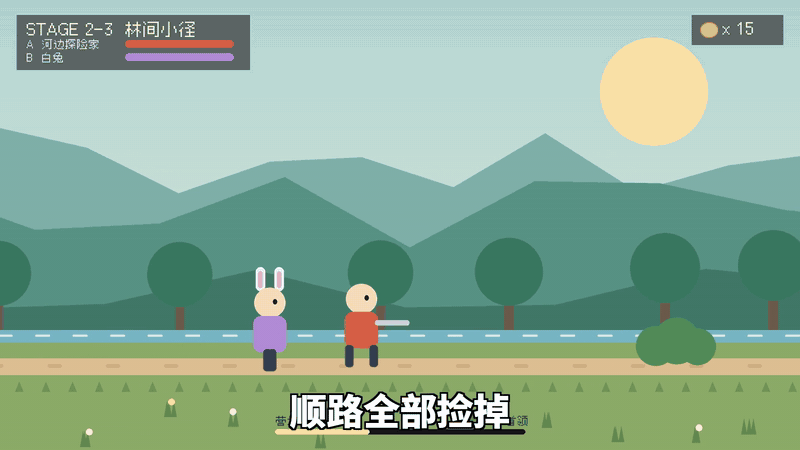
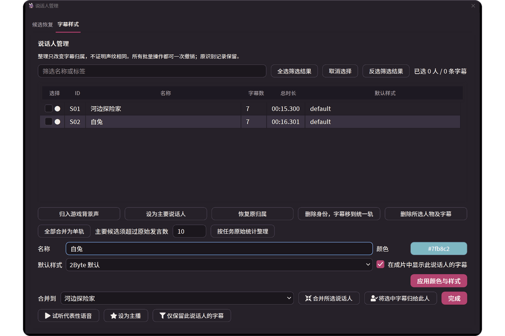
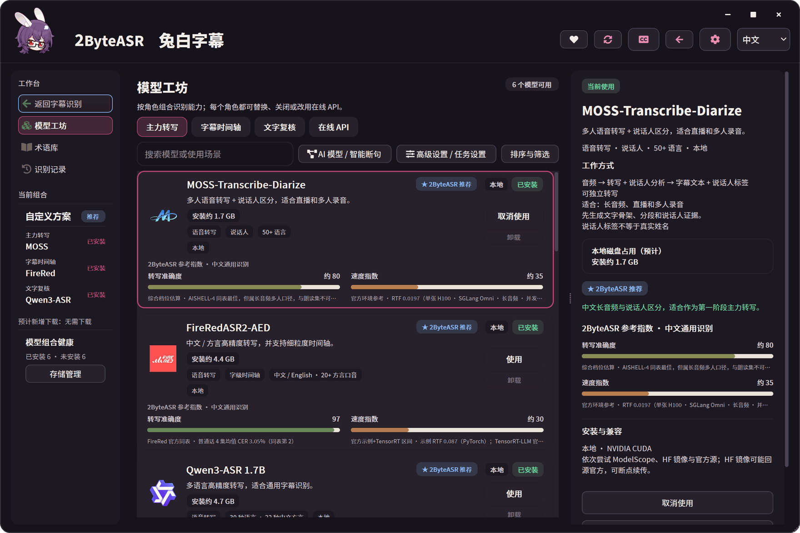

<div align="center">

<picture>
  <source media="(prefers-color-scheme: dark)" srcset="docs/assets/readme/banner-zh-dark.png">
  
</picture>

### 游戏实况字幕，从识别到成片。

三个本地模型分工识别，每个字都有时间；<br>
在字幕工作台里校对、剪辑、调样式，导出字幕或直接压制成片。

[](#下载与安装)
[](#下载与安装)
[](#下载与安装)
[](#许可与第三方说明)

**中文** · [English](README_EN.md) · [日本語](README_JA.md)

[下载与安装](#下载与安装) · [功能一览](#功能一览) · [模型目录](#模型目录) · [从源码运行](#从源码运行) · [许可](#许可与第三方说明)

</div>

<br>



<sub>以上与下文均为软件真实界面（2026-10-09 开发版）。示例素材是项目自制的动画画面和合成双人语音，字幕由本机 MOSS + FireRedASR2-AED + Qwen3-ASR 识别，再在工作台里修正断句。<a href="docs/assets/readme/README.md">素材说明</a></sub>

## 功能一览

- **三路模型分工**：主力转写写出文字并区分说话人，字幕时间轴把每个字落到时间上，文字复核用另一个模型再听一遍。
- **说话人自动分轨**：不同的人各占一条字幕轨，可以改名、设颜色和默认样式。
- **按字切分，候选对照**：剃刀沿字词边界切开字幕；模型意见不一致时并排对照，一键采用。
- **游戏术语库**：角色名、技能和常见错词按游戏整理，识别和校对时一起用。
- **样式、动效与压制**：预设、字体、描边和入场动效即时预览，直接导出带字幕的视频。
- **本地优先**：模型下载后可离线识别；需要时再接入自己的在线识别或 AI 服务。

## 导入素材，选好识别方案



首页把素材、识别方案和术语放在同一页。“先选目标”提供现成组合，例如质量优先的 **MOSS + FireRedASR2-AED + Qwen3-ASR**；每个角色都能单独换模型或关闭。AI 智能断句和 AI 校对是可选步骤，可以在首页关闭；开启时使用你自己配置的服务。

## 每一步都看得见

<p align="center">
  
  
</p>

进度页列出当前步骤、每一步的用时与结果，完整运行日志同步保存在项目报告中。完成后给出字幕条数、待检查项和全部字幕预览，可以直接导出，或进入工作台继续修。

<sub>示例为 34 秒素材在本机 RTX 5070 Ti 上的一次实际运行，含模型加载；不同设备和素材的耗时会不同。</sub>

## 剃刀切在字缝里



本地规则把“先走”切成了两半。合并两段，按住剃刀拖到正确位置，预览卡实时显示前段和后段，松开即切开。切点落在识别出的字词边界上，随时可以撤销。

## 模型意见不一致？并排对照



MOSS 和 FireRedASR2-AED 听成“拉住**他**”，Qwen3-ASR 听成“拉住**它**”。审核模式把不同版本并排列出并标出差异字，点一下就采用，自动跳到下一条。

## 样式、动效与压制成片

<p align="center"></p>

<p align="center">
  
  
</p>

说话人管理里可以改名、设颜色和默认样式；样式面板调整字号、描边和入场动效，画面即时更新。压制完成后列出编码、分辨率、码率和耗时。上面的动图截自软件实际导出的 MP4。

<sub>压制完成页中本机的输出路径已遮住。</sub>

## 更多

<p align="center">
  
  
</p>

**游戏术语库**按游戏整理角色名、技能和常见错词，标明来源与确认状态。**模型工坊**按角色列出可用模型，显示体积、运行方式和参考指数，一键下载或切换。


默认的**深葡萄紫**之外，还有暖奶油、暖夜炭、薰衣草和岩灰四套主题；界面语言可选中文、English、日本語。

## 模型目录

**主力转写**

- 本地：**MOSS-Transcribe-Diarize**（多人与说话人区分）、SenseVoice Small（可用 CPU）、FireRedASR2-AED、Qwen3-ASR 1.7B、Paraformer Large、Whisper large-v3-turbo、Fun-ASR Nano、FireRedASR2-LLM、GLM-ASR-Nano、Canary-Qwen-2.5B（英语）
- 在线（自备账号）：Qwen Audio 3.1 长音频转写、Spark-ASR 2.0、Groq Whisper、OpenAI Transcribe、MAI 2.1（OpenRouter）、OpenAI 兼容接口

**字幕时间轴**

- 本地：**FireRedASR2-AED**、Qwen3-ForcedAligner 0.6B、Paraformer Large、Whisper large-v3-turbo

**文字复核**

- 本地：**Qwen3-ASR 1.7B**、SenseVoice Small、Whisper large-v3-turbo、FireRedASR2-LLM、Fun-ASR Nano
- 在线：与主力转写相同的在线接口

粗体为“质量优先”组合。MOSS、FireRedASR2-AED、Qwen3-ASR 等本地模型需要 NVIDIA CUDA 显卡；SenseVoice Small 可以只用 CPU。模型权重不随程序附带，在模型工坊里按需下载，每个模型遵守各自的许可。在线接口按服务方条款计费，其中部分为实验接入；Omnilingual ASR LLM 7B 目前只列出权重，原生 Windows 暂不支持推理。

## 下载与安装

> [!NOTE]
> 公开安装包尚未发布。0.5.0 预发布（Windows x64 与 macOS Apple Silicon 实验版）正式发布后会出现在 [Releases](https://github.com/NOTBAD314/2ByteASR/releases)。现在可以先[从源码运行](#从源码运行)。

| 系统 | 要求 | 状态 |
| --- | --- | --- |
| Windows | Windows 10 22H2（19045）及以上，x64；本地 GPU 模型需 NVIDIA 显卡 | 主要平台 |
| macOS | macOS 15 及以上，Apple Silicon | 实验：已验证 SenseVoice CPU 主流程，未作 Developer ID 签名与公证，见[说明](docs/deployment/macos-experimental.zh-CN.md) |

**上手三步**

1. 打开**模型工坊**，下载要用的模型，或填写在线服务的账号与密钥。
2. 回到首页，拖入视频或音频，选好识别方案，点**开始生成字幕**。
3. 完成后进入**字幕工作台**校对、精修，导出字幕或压制成片。

| 用途 | 格式 |
| --- | --- |
| 导入 | MP4、MOV、MKV、WebM、FLV、AVI；MP3、WAV、M4A、FLAC、AAC |
| 字幕与文稿 | SRT、ASS、TXT、JSON；说话人可合并或分别导出 |
| 成片 | MP4、MKV、MOV |

更多安装、模型和格式说明见[使用指南](docs/product-guide.zh-CN.md)。

## 从源码运行

```powershell
git clone https://github.com/NOTBAD314/2ByteASR.git
cd 2ByteASR
.\setup_environment.bat
.\.venv-main\Scripts\python.exe quick_start.py
```

本仓库是 0.5.0 的独立源码范围（2026-10-02 快照），不包含完整安装包的全部对应源码，也未验证可直接完整打包；上面的截图来自更新的开发版，界面会有差别。构建条件见[源码范围](SOURCE_ONLY_SCOPE.md)与[构建说明](BUILD_FROM_SOURCE.md)，参与开发见[贡献指南](CONTRIBUTING.md)。

## 许可与第三方说明

- **自有代码**采用 [GPL-3.0-only](LICENSE)（[适用范围](PROJECT_LICENSE.md)）。官方版本免费提供；可以依 GPL 商用、修改和分发，分发时须履行提供对应源码等义务。私人修改无需公开；用本软件做出的普通字幕、视频和图片不会仅因此适用 GPL。
- **第三方组件**保留各自许可，例如 Qt／PySide6、FFmpeg、mpv。高保真渲染用到的 **Remotion** 对个人和员工不超过 3 人的营利组织免费，更大的营利组织需另购其 Company License；**GSAP** 采用其标准条款，不是 MIT。逐项说明见[第三方声明](THIRD_PARTY_NOTICES.md)。
- **模型权重**不随程序分发，下载后按各自许可使用（Apache-2.0、MIT、CC-BY-4.0、FunASR 模型许可协议等），见[模型许可表](licenses/MODELS.md)。
- **在线服务**使用你自己的账号与密钥，按服务方条款计费；启用后，相应音频或文字会发送到所选服务。
- 完整安装包的公开分发材料仍在整理，进度见[分发状态](licenses/DISTRIBUTION-STATUS.md)与[对应源码提供说明](SOURCE_DELIVERY.md)。

## 反馈

在 [Issues](https://github.com/NOTBAD314/2ByteASR/issues) 提交问题时，请附上版本、所用模型、复现步骤和截图。
