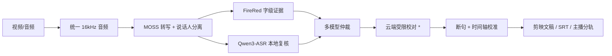

<div align="center">


# 2ByteASR

**拖进视频，出字幕 —— 面向中文游戏实况的本地字幕流水线**

[中文](README.md) · [English](README_EN.md) · [日本語](README_JA.md)


</div>

---

## ✨ 特性

- 🎙️ **说话人分离**：自动识别多位主播，输出「主播分轨 SRT」，同时说话也不丢
- 🧬 **三路转写交叉校验**：MOSS 骨架 + FireRed 字级证据 + Qwen3-ASR 本地复核，多模型仲裁减少错字
- 🔒 **隐私优先**：模型全部本地运行；云端校对可选且只发送文本，密钥用 Windows DPAPI 加密保存
- 🖥️ **一键安装**：Release 安装包自动配置环境并下载模型，断点续传
- 📄 **多格式输出**：剪映文稿 TXT、总 SRT、主播分轨 SRT、任务报告（含每个错误修正的可追溯记录）
- ⚡ **断点续跑**：同一素材二次运行命中阶段缓存，通常快很多

## 🖼️ 界面一览

| 工作台 | 处理进度 | 完成结果 |
| --- | --- | --- |
|  |  |  |

## 🔄 处理流程



> \* 云端校对默认可用；开启后仅发送转写文本，原文保护与断句约束由内置只读提示词强制保证。

## 🚀 快速开始

### 方式一：便携精简版（推荐，国内网络友好）

1. 从 [Releases](https://github.com/NOTBAD314/2ByteASR/releases) 下载 `2ByteASR-lite-<日期>.7z`（约 1 GB，内置 git/ffmpeg/python/uv 与全部 Python 依赖，离线安装）并解压到任意目录（如 `D:\2ByteASR`）
2. 双击 `setup_2byteasr.bat` —— 内置 git/ffmpeg/python/uv，**无需联网安装任何工具**
3. 自动完成：Python 环境（本地安装）→ 依赖包（清华镜像）→ 模型下载（hf-mirror 国内镜像，约 7 GB，可断点续传）
4. 双击 `2ByteASR.exe`，把视频或音频**拖进窗口**，点击开始

> 完整离线便携包（约 9.9 GB，**含全部模型、零下载解压即用**）因超过 GitHub 单文件限制，走网盘等渠道分发（见 Releases 说明）。

### 方式二：安装包

1. 从 [Releases](https://github.com/NOTBAD314/2ByteASR/releases) 下载 `2ByteASR-Setup-<版本>.exe` 并安装
2. 保持勾选「首次配置环境并下载模型」，等待模型下载完成（默认约 7 GB；可选附加 Qwen 复核模型后约 11.7 GB，可断点续传）
3. 双击桌面「2ByteASR」，把视频或音频**拖进窗口**，点击开始

### 方式三：从源码运行

```bat
setup_environment.bat    :: 创建 Python 环境并获取固定版本依赖
download_models.bat      :: 下载模型（输入 YES 确认）
install_shortcut.bat     :: 安装桌面快捷方式
```

之后把媒体文件直接拖到 `2ByteASR.bat` 上即可。

### 系统要求

- Windows 10/11 x64
- NVIDIA 显卡（建议 8GB+ 显存；**显存更低或显卡稍弱也能运行，只是更慢**）
- 模型默认约 7 GB（含可选 Qwen 约 11.7 GB），建议安装盘预留 15GB 以上

### 🌐 国内网络

安装流程已针对国内网络优化，无需额外配置：

- **模型下载**：默认走 HuggingFace 国内镜像（hf-mirror.com）；如需官方源，设置环境变量 `HF_ENDPOINT=https://huggingface.co`
- **模型组合**：默认约 7GB（MOSS 转写/说话人、FireRed 字级时间轴、声纹）；安装时提示可选附加 Qwen3-ASR 复核模型（+4.7GB，提升准确度）——不选也能正常出字幕，可后续用 `download_models.bat` 补下（或设置 `2BYTEASR_INCLUDE_QWEN=1` 跳过提示）
- **Python 依赖**：默认走清华 PyPI 镜像；可用 `UV_DEFAULT_INDEX` 覆盖
- **Python 本体**：python.org 官方与华为云镜像自动切换
- **离线安装**：网络确实很差的机器，可下载离线素材包（`models/` + `third_party/`，约 12GB，见 Releases 附件说明）。用法：解压后把 `models` 和 `third_party` 两个文件夹复制到安装目录（便携版解压目录，或安装版 `%LOCALAPPDATA%\Programs\2ByteASR\`），再运行 `setup_2byteasr.bat` 会自动跳过模型与源码下载（首次仍会安装 Python 环境，约几分钟）

#### 环境变量一览

| 变量 | 作用 | 默认 |
|---|---|---|
| `HF_ENDPOINT` | HuggingFace 下载源 | `https://hf-mirror.com` |
| `UV_DEFAULT_INDEX` | Python 依赖源 | 清华 PyPI 镜像 |
| `UV_CACHE_DIR` | 依赖缓存目录（避免占系统盘） | 项目内 `.uv-cache` |
| `2BYTEASR_INCLUDE_QWEN` | `=1` 时跳过提问、直接包含 Qwen 复核模型 | 未设置（交互提问） |
| `2BYTEASR_NO_QWEN` | `=1` 时跳过提问且不下载 Qwen | 未设置 |
| `2BYTEASR_CPU_ONLY` | `=1` 时即使有 NVIDIA 显卡也不升级 CUDA torch | 未设置（自动检测） |
| `2BYTEASR_FORCE_SETUP` | `=1` 时强制重装（重建环境；正常重跑会自动跳过已配置项） | 未设置 |

## 🗣️ 主播声纹（可选）

想让人名跟着声音走？每人放一段 5–14 秒的清晰独白 WAV 到 `%LOCALAPPDATA%\2ByteASR\host_voiceprints\samples\`，然后运行：

```bat
.venv-main\Scripts\python.exe register_host_voiceprint.py
```

不注册也可以分轨，只是跨视频时 `S01/S02` 标签不保证对应同一位主播。

## ☁️ 云端数据

本地模型不联网。开启云端校对与全文断句时，转写文本会发送到你选择的 OpenAI 兼容服务（默认阿里云百炼），并附带只读提示词；API 密钥仅保存在本机（DPAPI 加密），报告与日志不含密钥。

## 🛠️ 开发

```bat
run_tests.bat                                    :: 离线单元测试（无需 GPU/网络）
python scripts\check_release_hygiene.py          :: 发布前检查
```

详细文档：[架构](ARCHITECTURE.md) · [配置](CONFIGURATION.md) · [更新维护](UPDATING.md) · [安全](SECURITY.md)

## 📄 许可证

[Apache-2.0](LICENSE) · 第三方归属见 [THIRD_PARTY_NOTICES.md](THIRD_PARTY_NOTICES.md)
