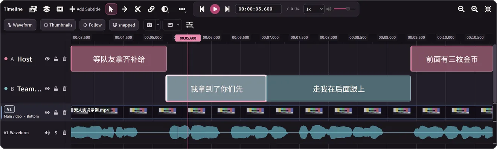

<div align="center">


# 2ByteASR · 兔白字幕

**Accurate subtitles. Easier video editing.**

A free subtitle transcription and video editing tool for game streams, with local processing.<br>
Transcribe, proofread, design animated subtitles, and export your video in one place.

[Download and quick start](#download-and-quick-start) · [Feature tour](#one-set-of-subtitles-three-roles) · [Interface](#the-interface) · [Models](#model-catalog)

[中文](README.md) · **English** · [日本語](README_JA.md)

</div>

## One set of subtitles, three roles

Transcription turns speech into text, timing places every character on the timeline, and review lets you compare different readings of the same line. Choose a combination for your media and hardware, then enable AI sentence segmentation as needed.


| Role | What it does | Options |
| --- | --- | --- |
| Primary transcription | Writes the text; MOSS can also tell speakers apart and give each one a track | MOSS, SenseVoice, Whisper |
| Subtitle timeline | Gives every character a start and end time, so segmentation and cuts follow character boundaries | FireRedASR2-AED, Paraformer; Qwen3-ForcedAligner for existing text |
| Text review | Listens again with another model and flags characters written differently | Qwen3-ASR and other local or online options |

## Split at character boundaries and shape the rhythm

Every character has its own start and end time. Drag the razor and it only stops between characters, with a card previewing both halves; release to cut and the timing follows the text. Cut in the wrong place? Undo with one key.



## Compare alternatives, then apply your choice

“他” (him) or “它” (it)? Three models each listen separately, and characters they write differently are flagged. See the differences and their sources under the same subtitle, then click to apply one and the current line updates.


## Game glossaries: organize once, use again

Keep character names, aliases, and common recognition errors organized by game. Check reference terms and their sources, then confirm them for recognition and proofreading. Your glossary is ready for the next recording.


## Stream highlights and animated subtitles

**Find the moments worth cutting.** Use stream chat XML and subtitles to find candidates such as a low-health comeback, a funny failure, or a burst of chat activity. Each candidate explains why and gives its time range; add the ones you like to your edit.


**Give each line its own expression.** Fonts, materials, entrances, and exits come together in a subtitle design. Reuse an existing style, or configure an AI design service to create and revise one. Subtitle design and highlight selection can be used independently.


*Woodcut: wooden panels close, engraved lettering appears, and the panels fold away. CRT scoreboard: power on, glowing text, and a screen-off exit.*

## The interface

<p align="center">
  
  
</p>

Subtitle Studio on the left, the home screen on the right. More screenshots are in the [interface tour](docs/product-demo.en.md).

## Download and quick start

**The current release is 0.7.1: Windows x64, plus macOS on Apple Silicon (experimental).** Get the newest version from the [Latest Release](https://github.com/NOTBAD314/2ByteASR/releases/latest); SHA-256 digests are in the release's `SHA256SUMS.txt`.

- **Windows:** download only [`2ByteASR-Setup-0.7.1.exe`](https://github.com/NOTBAD314/2ByteASR/releases/download/v0.7.1/2ByteASR-Setup-0.7.1.exe) (about 1 GB). From 0.6.5 or 0.7.0, use "Check for updates" in the app; it downloads only the changed parts and keeps compatible models and environments. Install over 0.6.0 or earlier without uninstalling first. The installer is not Windows code-signed, so Windows may show an "unknown publisher" prompt.
- **macOS (experimental; Apple Silicon, macOS 15 or later):** [`2ByteASR-0.7.1-macos-arm64-Setup.dmg`](https://github.com/NOTBAD314/2ByteASR/releases/download/v0.7.1/2ByteASR-0.7.1-macos-arm64-Setup.dmg) (about 0.5 GB). It is not signed with a Developer ID or notarized by Apple: the first time, Control-click the app in Finder and choose "Open"; there is no need to turn off system security. Intel Macs are not supported. It has been tested only on GitHub's virtual Macs; see the [notes](docs/deployment/macos-experimental.zh-CN.md) (in Chinese).
- **No NVIDIA GPU:** cloud recognition works on its own (with your own provider account and API key); no local models are needed.

The first local recognition still downloads the runtime environment and models you choose in the Model workshop.

1. **Install and launch.** Run the Setup installer, then launch the app.
2. **Prepare recognition.** Set up local models in the Model workshop, or configure your own online service.
3. **Import and transcribe.** Choose your media, content settings, and glossary, then check the text, character timing, and speaker results.
4. **Open Subtitle Studio.** Proofread, split or merge lines, adjust subtitles and video, then export subtitles, a transcript, or a video with subtitles burned in.

The default theme is **Deep Grape**; Appearance settings also offer Warm Cream, Warm Night, Lavender and Slate.

### Requirements

- **System:** Windows 10 22H2 (19045) or later, x64; macOS 15 or later on Apple Silicon (experimental, without Developer ID signing or notarization; see the [notes](docs/deployment/macos-experimental.zh-CN.md), in Chinese).
- **Local recognition:** Download model weights as needed in the Model workshop. SenseVoice supports CPU processing; on Windows, MOSS, FireRedASR2-AED, Qwen3-ASR and similar models use NVIDIA CUDA; on Apple silicon Macs, MOSS and FireRedASR2-AED use the Apple GPU (slower, experimental).
- **Online services:** Use your own account or API key. Billing follows your provider's terms.
- **Output:** SRT, ASS, TXT, JSON, separate speaker tracks, and MP4, MKV, or MOV video.

### Run from source

```powershell
git clone https://github.com/NOTBAD314/2ByteASR.git
cd 2ByteASR
.\setup_environment.bat
.\.venv-main\Scripts\python.exe quick_start.py
```

`main` holds the application source from 0.6.5 on. The tag `v0.7.1` is the build source that matches the 0.7.1 installer byte for byte; the complete build inputs are in the release's `2ByteASR-Source-0.7.1.zip`. Project-owned code is GPL-3.0-only with an additional permission for Remotion/GSAP; see [PROJECT_LICENSE.md](PROJECT_LICENSE.md).

## Model catalog

- **Primary transcription:** MOSS-Transcribe-Diarize (multi-speaker with diarization), SenseVoice Small (CPU capable), FireRedASR2-AED, Qwen3-ASR 1.7B, Paraformer Large, Whisper large-v3-turbo, Fun-ASR Nano, FireRedASR2-LLM, GLM-ASR-Nano, Canary-Qwen-2.5B (English)
- **Subtitle timeline:** FireRedASR2-AED, Qwen3-ForcedAligner 0.6B, Paraformer Large, Whisper large-v3-turbo
- **Text review:** Qwen3-ASR 1.7B, SenseVoice Small, Whisper large-v3-turbo, FireRedASR2-LLM, Fun-ASR Nano
- **Online endpoints (your own account):** MOSS Pro cloud (MOSI, with speakers), Alibaba Cloud Bailian / Qwen Cloud file transcription (Qwen3-ASR word times, Qwen-Audio 3.1 with speakers), Spark-ASR 2.0, Groq Whisper, OpenAI Transcribe, MAI 2.1 (OpenRouter), OpenAI-compatible endpoints

Model weights are not bundled; download them in the Model workshop. Each model follows its own license.

## Documentation and feedback

[Interface tour](docs/product-demo.en.md) · [User guide](docs/product-guide.en.md) · [Source delivery](SOURCE_DELIVERY.md) · [Report an issue](https://github.com/NOTBAD314/2ByteASR/issues)

Include your version, model, steps to reproduce, and screenshots when reporting an issue.

Project-owned code is licensed under **GPL-3.0-only** ([English license](LICENSE), [scope](PROJECT_LICENSE.md)). Official versions are free; GPL permits commercial use, modification and paid distribution subject to its source and other conditions. Private changes need not be published. Ordinary subtitle, video and image outputs do not become GPL merely through use of this software. Third-party components keep their own licenses: Remotion, used by the high-fidelity renderer, is free for individuals and for-profit organizations of up to 3 employees, while larger for-profit organizations need its Company License; GSAP uses its standard license. See the [third-party notices](THIRD_PARTY_NOTICES.md) and [model license table](licenses/MODELS.md); distribution materials for the full installer are still being completed ([status](licenses/DISTRIBUTION-STATUS.md)).
