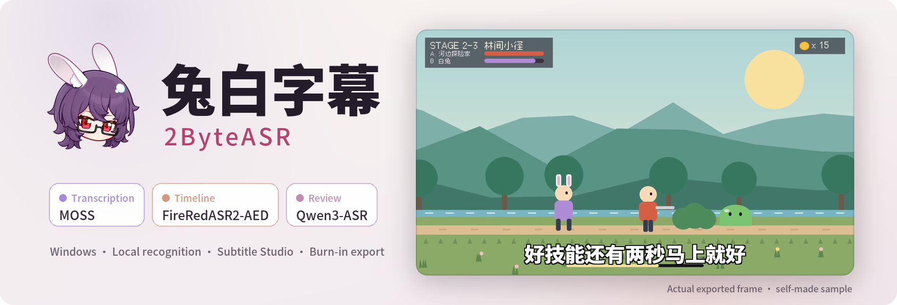

<div align="center">

<picture>
  <source media="(prefers-color-scheme: dark)" srcset="docs/assets/readme/banner-en-dark.png">
  
</picture>

### Game stream subtitles, from recognition to final cut.

Three local models share the work, and every character gets a timestamp.<br>
Proofread, cut and style in Subtitle Studio, then export subtitles or burn them into the video.

[](#download-and-install)
[](#download-and-install)
[](#download-and-install)
[](#license-and-third-party-terms)

[中文](README.md) · **English** · [日本語](README_JA.md)

[Download](#download-and-install) · [Features](#features) · [Models](#model-catalog) · [Run from source](#run-from-source) · [License](#license-and-third-party-terms)

</div>

<br>


<sub>Every image on this page is the real app (development build, 2026-10-09). The sample is a self-made animation with two synthetic Chinese voices, recognised locally with MOSS + FireRedASR2-AED + Qwen3-ASR and then tidied up in Studio. Feature clips below show the Chinese UI; the app also ships English and Japanese UI. <a href="docs/assets/readme/README.md">About these assets</a></sub>

## Features

- **Three models, three jobs.** Primary transcription writes the text and separates speakers, the subtitle timeline places every character in time, and text review listens again with a second model.
- **Automatic speaker tracks.** Each person gets their own subtitle track, with a name, colour and default style.
- **Cut by character, compare candidates.** The razor cuts along word boundaries; when models disagree, their versions sit side by side and one click adopts the right one.
- **Game term libraries.** Character names, skills and common misrecognitions are organised per game and used in recognition and proofreading.
- **Styles, motion and burn-in.** Presets, fonts, outlines and entrance effects preview instantly, and the video exports with subtitles burned in.
- **Local first.** Once models are downloaded, recognition runs offline. Online recognition or AI services are optional and use your own accounts.

## Bring in media and pick a recognition plan


Media, recognition plan and terms share one page. "Pick a goal first" offers ready-made combinations, for example the quality-first **MOSS + FireRedASR2-AED + Qwen3-ASR**, and every role can switch model or be turned off. AI smart segmentation and AI proofreading are optional steps you can turn off on the home screen; when on, they use a service you configure.

## Every step is visible

<p align="center">
  
  
</p>

The progress page shows the current step and the time and result of every step; the full run log is saved with the project report. When it finishes you get the subtitle count, items to check and a full preview, ready to export or to open in Studio.

<sub>One real run of the 34-second sample on a local RTX 5070 Ti, model loading included. Timing varies with hardware and media.</sub>

## A razor that cuts between characters


The local rules split a phrase in the wrong place. Merge the two pieces, drag the razor to the right spot while the card previews both halves, and release to cut. Cuts land on recognised word boundaries and can always be undone.

## When models disagree, compare them


MOSS and FireRedASR2-AED heard 拉住**他** ("hold him"), Qwen3-ASR heard 拉住**它** ("hold it", referring to the monster). Review mode lists the versions side by side, highlights the differing character, adopts one with a click and moves to the next line.

## Styles, motion and the final video

<p align="center"></p>

<p align="center">
  
  
</p>

The speaker manager renames speakers and sets colours and default styles. The style panel changes size, outline and entrance motion with an instant preview. When encoding finishes you see codec, resolution, bitrate and time taken. The animation above is cut from the MP4 the app actually exported.

<sub>The local output path on the encode page has been masked.</sub>

## More

<p align="center">
  
  
</p>

The **term library** keeps character names, skills and common misrecognitions per game, with sources and confirmation status. The **model workshop** lists the models for each role with size, runtime and reference scores, and downloads or switches them in one place.


Besides the default **Deep Grape / Burgundy** theme there are Warm Cream / Green, Warm Night / Cream, Lavender Workspace and Slate / Editorial. The interface is available in Chinese, English and Japanese.

## Model catalog

**Primary transcription**

- Local: **MOSS-Transcribe-Diarize** (multi-speaker with diarization), SenseVoice Small (CPU capable), FireRedASR2-AED, Qwen3-ASR 1.7B, Paraformer Large, Whisper large-v3-turbo, Fun-ASR Nano, FireRedASR2-LLM, GLM-ASR-Nano, Canary-Qwen-2.5B (English)
- Online (your own account): Qwen Audio 3.1 long-audio, Spark-ASR 2.0, Groq Whisper, OpenAI Transcribe, MAI 2.1 (OpenRouter), OpenAI-compatible endpoints

**Subtitle timeline**

- Local: **FireRedASR2-AED**, Qwen3-ForcedAligner 0.6B, Paraformer Large, Whisper large-v3-turbo

**Text review**

- Local: **Qwen3-ASR 1.7B**, SenseVoice Small, Whisper large-v3-turbo, FireRedASR2-LLM, Fun-ASR Nano
- Online: the same online endpoints as primary transcription

Bold entries form the quality-first combination. MOSS, FireRedASR2-AED, Qwen3-ASR and similar local models need an NVIDIA CUDA GPU; SenseVoice Small can run on CPU only. Model weights are not bundled. Download them in the model workshop; each model follows its own license. Online endpoints are billed by their providers, and some are experimental. Omnilingual ASR LLM 7B is listed as weights only; native Windows inference is not supported.

## Download and install

> [!NOTE]
> No public installer has been released yet. The 0.5.0 pre-release (Windows x64 and an experimental macOS Apple Silicon build) will appear under [Releases](https://github.com/NOTBAD314/2ByteASR/releases) once published. Meanwhile you can [run from source](#run-from-source).

| System | Requirements | Status |
| --- | --- | --- |
| Windows | Windows 10 22H2 (19045) or later, x64; local GPU models need an NVIDIA GPU | Main platform |
| macOS | macOS 15 or later, Apple Silicon | Experimental: the SenseVoice CPU workflow is verified; no Developer ID signature or notarization. See the [notes](docs/deployment/macos-experimental.zh-CN.md) (Chinese) |

**Three steps to start**

1. Open the **Model workshop** and download the models you want, or enter the keys for an online service.
2. Back on the home screen, drop in a video or audio file, choose a recognition plan and click **Start subtitles**.
3. Open **Subtitle Studio** to proofread and polish, then export subtitles or encode the final video.

| Purpose | Formats |
| --- | --- |
| Import | MP4, MOV, MKV, WebM, FLV, AVI; MP3, WAV, M4A, FLAC, AAC |
| Subtitles and transcripts | SRT, ASS, TXT, JSON; speakers merged or exported separately |
| Final video | MP4, MKV, MOV |

Installation, model and format details are in the [user guide](docs/product-guide.en.md).

## Run from source

```powershell
git clone https://github.com/NOTBAD314/2ByteASR.git
cd 2ByteASR
.\setup_environment.bat
.\.venv-main\Scripts\python.exe quick_start.py
```

This repository is the standalone 0.5.0 source scope (snapshot of 2026-10-02). It is not the complete corresponding source of the full installer, and a complete package build from it has not been verified. The screenshots come from a newer development build, so the interface will differ. See the [source scope](SOURCE_ONLY_SCOPE.md), [build notes](BUILD_FROM_SOURCE.md) and [contributing guide](CONTRIBUTING.md).

## License and third-party terms

- **Project code** is licensed under [GPL-3.0-only](LICENSE) ([scope](PROJECT_LICENSE.md)). Official builds are free. You may use, modify and distribute it commercially under the GPL, including the obligation to provide corresponding source. Private modifications need not be published, and ordinary subtitles, videos and images made with the app do not become GPL-licensed just because of that.
- **Third-party components** keep their own licenses, for example Qt/PySide6, FFmpeg and mpv. **Remotion**, used by the high-fidelity renderer, is free for individuals and for-profit organisations of up to 3 employees; larger for-profit organisations need its Company License. **GSAP** uses its standard license, not MIT. Details are in the [third-party notices](THIRD_PARTY_NOTICES.md).
- **Model weights** are not distributed with the app and are used under their own licenses once downloaded (Apache-2.0, MIT, CC-BY-4.0, the FunASR model license and others). See the [model license table](licenses/MODELS.md).
- **Online services** use your own accounts and keys and are billed by their providers. When enabled, the relevant audio or text is sent to the selected service.
- Distribution materials for the full installer are still being completed; see the [distribution status](licenses/DISTRIBUTION-STATUS.md) and [source delivery notes](SOURCE_DELIVERY.md).

## Feedback

When filing an [issue](https://github.com/NOTBAD314/2ByteASR/issues), please include the version, the models used, steps to reproduce and screenshots.
