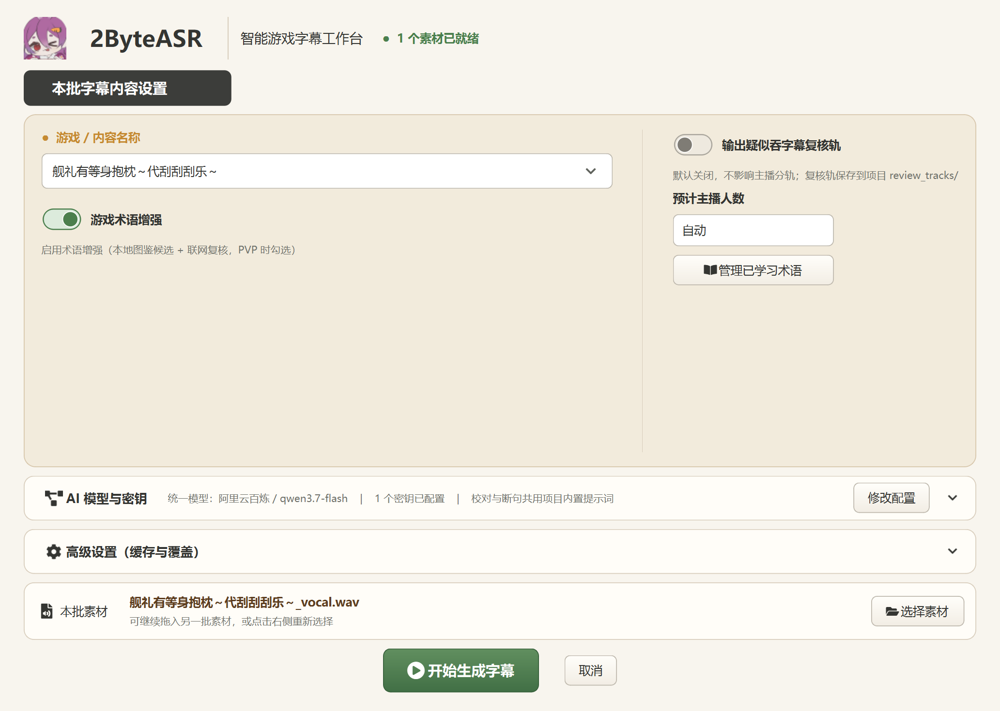
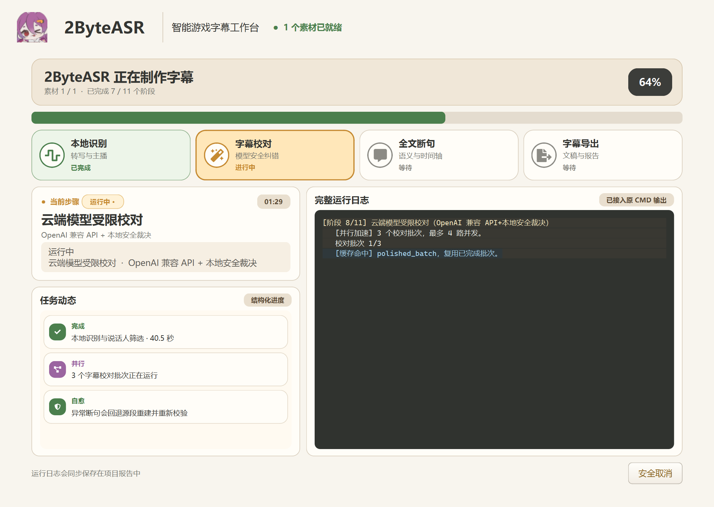
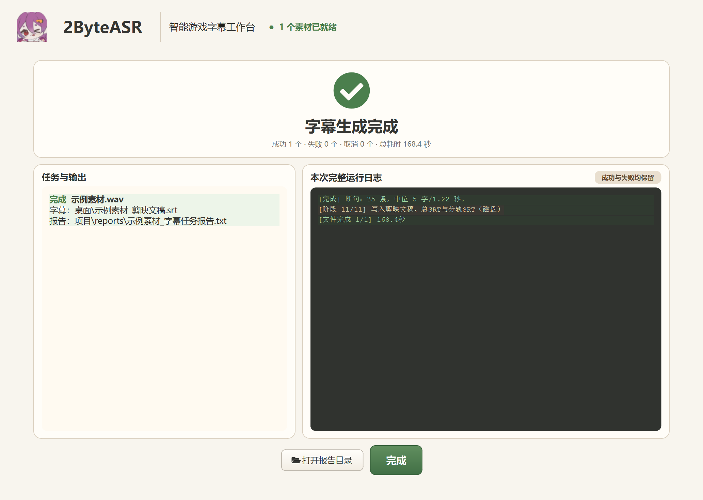
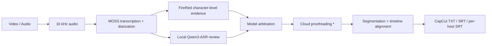

<div align="center">


# 2ByteASR

**Drop in a video, get subtitles — a local subtitle pipeline for Chinese gaming streams**

[中文](README.md) · [English](README_EN.md) · [日本語](README_JA.md)


</div>

---

## ✨ Features

- 🎙️ **Speaker diarization**: automatically separates hosts, outputs per-host subtitle tracks, keeps overlaps intact
- 🧬 **Three-way ASR cross-check**: MOSS skeleton + FireRed character-level evidence + local Qwen3-ASR review, arbitrated across models to cut misrecognition
- 🔒 **Privacy first**: all models run locally; cloud proofreading is optional and sends text only — API keys are stored with Windows DPAPI encryption
- 🖥️ **One-click install**: the Release installer sets up the environment and downloads models, with resumable downloads
- 📄 **Multiple outputs**: CapCut-ready TXT, full SRT, per-host SRT, and traceable task reports
- ⚡ **Resumable runs**: re-running the same media hits stage caches and finishes much faster

## 🖼️ Screenshots

| Workbench | Processing | Result |
| --- | --- | --- |
|  |  |  |

## 🔄 Pipeline



> \* Cloud proofreading is available out of the box; it sends transcribed text only, and read-only prompts enforce original-text preservation and segmentation constraints.

## 🚀 Quick Start

### Option 1: Installer (recommended)

1. Download `2ByteASR-Setup-<version>.exe` from [Releases](https://github.com/NOTBAD314/2ByteASR/releases) and run it
2. Keep "configure environment and download models" checked, and wait for the model download (~7 GB by default; ~11.7 GB with the optional Qwen reviewer; resumable)
3. Launch 2ByteASR from your desktop, **drag** a video or audio file into the window, and hit start

### Option 2: Run from source

```bat
setup_environment.bat    :: create Python environments and pinned dependencies
download_models.bat      :: download models (type YES to confirm)
install_shortcut.bat     :: install a desktop shortcut
```

Then simply drag media files onto `2ByteASR.bat`.

### Requirements

- Windows 10/11 x64
- NVIDIA GPU (8 GB+ VRAM recommended; **lower VRAM or a weaker card still works, just slower**)
- ~7 GB of models by default (~11.7 GB with the optional Qwen reviewer); keep 15 GB+ free on the install drive

## 🗣️ Host Voiceprints (optional)

Want names to follow the voices? Put one clear 5–14 s solo WAV per host in `%LOCALAPPDATA%\2ByteASR\host_voiceprints\samples\`, then run:

```bat
.venv-main\Scripts\python.exe register_host_voiceprint.py
```

Without enrollment you can still get per-host tracks, but `S01/S02` labels are not guaranteed to map to the same person across videos.

## ☁️ Cloud Data

Local models never touch the network. When cloud proofreading and segmentation are enabled, transcribed text is sent to the OpenAI-compatible service you choose (Aliyun Bailian by default) together with read-only prompts; API keys stay on your machine (DPAPI-encrypted) and never appear in reports or logs.

## 🛠️ Development

```bat
run_tests.bat                                    :: offline unit tests (no GPU/network needed)
python scripts\check_release_hygiene.py          :: pre-release checks
```

More docs: [Architecture](ARCHITECTURE.md) · [Configuration](CONFIGURATION.md) · [Updating](UPDATING.md) · [Security](SECURITY.md)

## 📄 License

[Apache-2.0](LICENSE) · Third-party attributions in [THIRD_PARTY_NOTICES.md](THIRD_PARTY_NOTICES.md)
