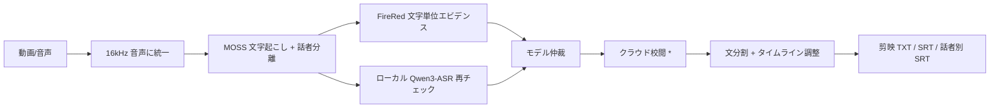

<div align="center">


# 2ByteASR

**動画をドロップするだけで字幕が完成 —— 中国語ゲーム実況向けローカル字幕パイプライン**

[中文](README.md) · [English](README_EN.md) · [日本語](README_JA.md)


</div>

---

## ✨ 特徴

- 🎙️ **話者分離**: 配信者を自動識別し、話者ごとの字幕トラックを出力。同時発言もそのまま保持
- 🧬 **3 モデル相互検証**: MOSS の骨格 + FireRed の文字単位エビデンス + ローカル Qwen3-ASR による再チェック。複数モデルの仲裁で誤字を削減
- 🔒 **プライバシー重視**: モデルはすべてローカル実行。クラウド校閲は任意でテキストのみ送信。API キーは Windows DPAPI で暗号化保存
- 🖥️ **ワンクリック導入**: Release インストーラが環境構築とモデルダウンロードを自動化（再開可能）
- 📄 **多彩な出力**: 剪映（CapCut）用 TXT、全体 SRT、話者別 SRT、追跡可能なタスクレポート
- ⚡ **再開可能**: 同じメディアを再処理するとステージキャッシュにヒットし、大幅に高速化

## 🖼️ スクリーンショット

| ワークベンチ | 処理中 | 結果 |
| --- | --- | --- |
|  |  |  |

## 🔄 処理フロー



> \* クラウド校閲は初期状態で利用可能。転写テキストのみ送信され、読み取り専用プロンプトが原文保持と文分割制約を保証します。

## 🚀 クイックスタート

### 方法 1：インストーラ（推奨）

1. [Releases](https://github.com/NOTBAD314/2ByteASR/releases) から `2ByteASR-Setup-<バージョン>.exe` をダウンロードして実行
2. 「環境設定とモデルダウンロード」にチェックを入れたまま、モデルダウンロード完了を待つ（既定約 7GB、任意の Qwen レビューモデル追加時は約 11.7GB、再開可能）
3. デスクトップから 2ByteASR を起動し、動画や音声を**ウィンドウにドラッグ**して開始

### 方法 2：ソースから実行

```bat
setup_environment.bat    :: Python 環境と固定版依存関係を構築
download_models.bat      :: モデルをダウンロード（YES を入力して確認）
install_shortcut.bat     :: デスクトップショートカットをインストール
```

あとはメディアファイルを `2ByteASR.bat` にドラッグするだけです。

### システム要件

- Windows 10/11 x64
- NVIDIA GPU（8GB 以上の VRAM 推奨。**VRAM が少なくても、非力な GPU でも動作します。遅いだけです**）
- モデルは既定で約 7GB（任意の Qwen 追加時は約 11.7GB）。インストール先ドライブに 15GB 以上の空きを推奨

## 🗣️ ホスト声紋（任意）

声に名前を追従させたい場合は、各配信者の 5〜14 秒のクリアな独白 WAV を `%LOCALAPPDATA%\2ByteASR\host_voiceprints\samples\` に置き、次を実行：

```bat
.venv-main\Scripts\python.exe register_host_voiceprint.py
```

登録しなくても話者別トラックは出力できますが、動画をまたいで `S01/S02` が同じ人に対応する保証はありません。

## ☁️ クラウドデータ

ローカルモデルはネットワークに接続しません。クラウド校閲と文分割を有効にすると、転写テキストが選択した OpenAI 互換サービス（デフォルトは Aliyun Bailian）に読み取り専用プロンプトとともに送信されます。API キーはローカルにのみ保存され（DPAPI 暗号化）、レポートやログには一切含まれません。

## 🛠️ 開発

```bat
run_tests.bat                                    :: オフライン単体テスト（GPU/ネット不要）
python scripts\check_release_hygiene.py          :: リリース前チェック
```

詳細ドキュメント：[アーキテクチャ](ARCHITECTURE.md) · [設定](CONFIGURATION.md) · [更新](UPDATING.md) · [セキュリティ](SECURITY.md)

## 📄 ライセンス

[Apache-2.0](LICENSE) · サードパーティ帰属は [THIRD_PARTY_NOTICES.md](THIRD_PARTY_NOTICES.md) を参照
