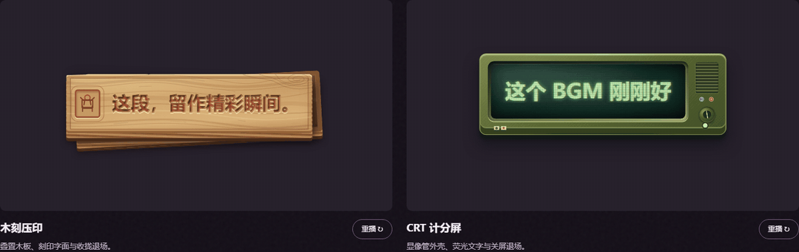

<div align="center">


# 2ByteASR · 兔白字幕

**正確な字幕で、動画編集をもっと手軽に。**

ゲーム実況向けの無料の字幕作成・動画編集ツール。ローカル環境で利用できます。<br>
文字起こしから校正、字幕エフェクト、動画の書き出しまで、ひとつのアプリで。

[ダウンロードとクイックスタート](#ダウンロードとクイックスタート) · [機能紹介](#ひとつの字幕を3つの役割で仕上げる) · [実際の画面](#実際の画面) · [モデル](#モデル一覧)

[中文](README.md) · [English](README_EN.md) · **日本語**

</div>

## ひとつの字幕を、3つの役割で仕上げる

文字起こしで話し言葉をテキストにし、タイミングで1文字ずつ時刻を付け、照合で同じ発話の認識結果を比較します。素材と機器に合わせてモデルを組み合わせ、必要に応じて AI による文の分割も利用できます。


| 役割 | できること | 主な選択肢 |
| --- | --- | --- |
| メイン転写 | テキスト化。MOSS は話者も区別し、話者ごとのトラックに分けられます | MOSS、SenseVoice、Whisper |
| 字幕タイムライン | 1文字ずつ開始・終了の時刻を付け、区切りも分割も文字の境界に沿います | FireRedASR2-AED、Paraformer。既存テキストには Qwen3-ForcedAligner |
| テキストレビュー | 別のモデルで聞き直し、書き方が違う文字を示します | Qwen3-ASR などのローカル／オンラインモデル |

## 文字の境界で切り、字幕のテンポを整える

1文字ずつ開始と終了の時刻があります。分割ツールをドラッグすると文字と文字の間にだけ止まり、カードに前半と後半が表示されます。離せば分割され、時刻は文字に付いてきます。切り間違えても、すぐ元に戻せます。


## 同じ発話の候補を比べて採用する

「他」（彼）か「它」（それ）か。3つのモデルがそれぞれ聞き取り、書き方の違う文字が示されます。同じ字幕の候補を並べて違いと認識元を確認し、クリックで採用すると現在の字幕が更新されます。


## ゲーム用語集：一度整理すれば、次の動画にも

キャラクター名、別名、よくある誤認識をゲームごとに管理。参考用語と出典を確認してから、認識と校正に使えます。次の素材でも、整理した用語集をそのまま活用できます。


## 配信の切り抜きと字幕エフェクト

**まず、切り抜きたい場面を見つける。** 配信コメントの XML と字幕から、瀕死からの逆転、思わず笑う失敗、コメントが集中した場面などを探します。候補ごとに理由と時間範囲が示され、気に入った場面を編集に追加できます。


**ひと言に、表情を添える。** フォント、質感、登場と退場の動きを組み合わせて字幕をデザイン。既存のスタイルを再利用したり、AI デザインサービスを設定して生成・修正したりできます。字幕デザインと切り抜き機能は、それぞれ単独でも使えます。



*木版画風：木の板が合わさり、刻まれた文字が現れ、折りたたまれて退場。CRT スコアボード風：電源が入り、文字が発光し、画面が消えて退場。*

## 実際の画面

<p align="center">
  
  
</p>

左が字幕スタジオ、右がホーム画面です。ほかの画面は[画面ツアー](docs/product-demo.ja.md)をご覧ください。

## ダウンロードとクイックスタート

インストーラーは [GitHub Releases](https://github.com/NOTBAD314/2ByteASR/releases) で Windows x64 と macOS Apple Silicon（実験版）向けに公開予定です。0.5.0 プレリリースはまだ公開していないため、現時点では[ソースから実行](#ソースから実行)できます。

1. **インストールして起動。** Windows は Setup を実行。Mac は DMG を開き、`2ByteASR.app` を `Applications` にドラッグして起動します。
2. **認識の準備。** モデルワークショップでローカルモデルを準備するか、利用するオンラインサービスを設定します。
3. **素材を読み込み、文字起こし。** 素材、コンテンツ設定、用語集を選び、認識テキスト、文字のタイミング、話者の結果を確認します。
4. **字幕スタジオを開く。** 校正、分割・結合、字幕と映像の調整を行い、字幕ファイル、原稿、字幕を焼き込んだ動画を書き出します。

既定のテーマは**ディープグレープ**。外観設定でウォームクリーム、ウォームナイト、ラベンダー、スレートにも変えられます。

### 動作条件

- **OS：** Windows 10 22H2（19045）以降の x64。macOS 15 以降の Apple Silicon（実験版、Developer ID 署名・公証なし。[説明](docs/deployment/macos-experimental.zh-CN.md)は中国語）。
- **ローカル認識：** モデルワークショップから必要なモデルの重みをダウンロードします。SenseVoice は CPU に対応。MOSS、FireRedASR2-AED、Qwen3-ASR などは NVIDIA CUDA を使用します。
- **オンラインサービス：** 自分のアカウントまたは API キーを使用します。料金は各サービスの規定に従います。
- **出力：** SRT、ASS、TXT、JSON、話者別トラック、MP4・MKV・MOV 動画。

### ソースから実行

```powershell
git clone https://github.com/NOTBAD314/2ByteASR.git
cd 2ByteASR
.\setup_environment.bat
.\.venv-main\Scripts\python.exe quick_start.py
```

このリポジトリは 0.5.0 の独立したソース範囲で、完全なインストーラーに対応するソース一式ではありません。ここからの完全なビルドも未検証です。[ソースの範囲とビルド条件](SOURCE_ONLY_SCOPE.md)をご確認ください。

## モデル一覧

- **メイン転写：** MOSS-Transcribe-Diarize（複数話者と話者分離）、SenseVoice Small（CPU 可）、FireRedASR2-AED、Qwen3-ASR 1.7B、Paraformer Large、Whisper large-v3-turbo、Fun-ASR Nano、FireRedASR2-LLM、GLM-ASR-Nano、Canary-Qwen-2.5B（英語）
- **字幕タイムライン：** FireRedASR2-AED、Qwen3-ForcedAligner 0.6B、Paraformer Large、Whisper large-v3-turbo
- **テキストレビュー：** Qwen3-ASR 1.7B、SenseVoice Small、Whisper large-v3-turbo、FireRedASR2-LLM、Fun-ASR Nano
- **オンライン（ご自身のアカウント）：** Qwen Audio 3.1 長時間音声、Spark-ASR 2.0、Groq Whisper、OpenAI Transcribe、MAI 2.1（OpenRouter）、OpenAI 互換エンドポイント

モデルの重みはアプリに同梱されません。モデルワークショップから必要に応じてダウンロードし、それぞれのライセンスに従って使います。

## ドキュメントとフィードバック

[画面ツアー](docs/product-demo.ja.md) · [利用ガイド](docs/product-guide.ja.md) · [ソース提供の説明](SOURCE_DELIVERY.md) · [問題を報告](https://github.com/NOTBAD314/2ByteASR/issues)

問題を報告する際は、バージョン、モデル、再現手順、スクリーンショットを添えてください。

プロジェクト固有のコードは **GPL-3.0-only** です（[英語の正式な全文](LICENSE)・[適用範囲](PROJECT_LICENSE.md)）。公式版は無料で提供します。GPL のソース提供等の条件に従い、商用利用・改変・有償再配布が可能です。私的な改変の公開は不要です。通常の字幕・動画・画像は、本ソフトで生成しただけで GPL の対象にはなりません。サードパーティのコンポーネントはそれぞれのライセンスに従います。高精度レンダリングに使う Remotion は個人と従業員 3 人までの営利組織は無料、それより大きい営利組織には Company License が必要です。GSAP は標準ライセンスです。[サードパーティ通知](THIRD_PARTY_NOTICES.md)と[モデルライセンス表](licenses/MODELS.md)をご覧ください。完全なインストーラーの配布資料は整備中です（[配布状況](licenses/DISTRIBUTION-STATUS.md)）。
