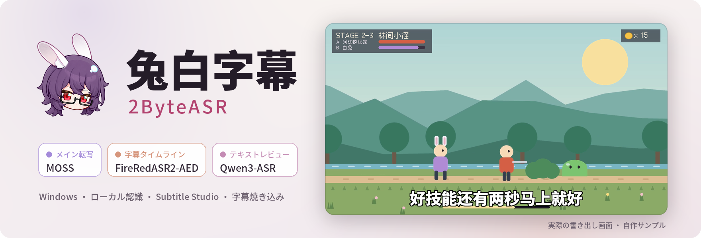

<div align="center">

<picture>
  <source media="(prefers-color-scheme: dark)" srcset="docs/assets/readme/banner-ja-dark.png">
  
</picture>

### ゲーム実況の字幕を、認識から完成動画まで。

3 つのローカルモデルが役割を分けて認識し、1 文字ずつ時刻が付きます。<br>
字幕スタジオで校正・カット・スタイル調整を行い、字幕を書き出すか動画に焼き込みます。

[](#ダウンロードとインストール)
[](#ダウンロードとインストール)
[](#ダウンロードとインストール)
[](#ライセンスとサードパーティ条件)

[中文](README.md) · [English](README_EN.md) · **日本語**

[ダウンロード](#ダウンロードとインストール) · [主な機能](#主な機能) · [モデル一覧](#モデル一覧) · [ソースから実行](#ソースから実行) · [ライセンス](#ライセンスとサードパーティ条件)

</div>

<br>


<sub>このページの画像はすべて実際のアプリ画面です（2026-10-09 開発版）。サンプルは自作アニメーションと合成音声による中国語の 2 人の会話で、ローカルの MOSS + FireRedASR2-AED + Qwen3-ASR で認識した後、スタジオで区切りを直しました。以下の機能クリップは中国語 UI ですが、アプリは日本語・英語 UI にも対応しています。<a href="docs/assets/readme/README.md">素材について</a></sub>

## 主な機能

- **3 つのモデルで分担**：メイン転写が文字起こしと話者分離を、字幕タイムラインが 1 文字ずつの時刻を、テキストレビューが別モデルでの聞き直しを担当します。
- **話者ごとの自動トラック**：話者ごとに字幕トラックが分かれ、名前・色・既定スタイルを設定できます。
- **文字単位のカットと候補比較**：レーザーは単語の境界でカット。モデル間で結果が違うときは並べて比べ、ワンクリックで採用できます。
- **ゲーム用語集**：キャラクター名、スキル、よくある誤認識をゲームごとに整理し、認識と校正に使います。
- **スタイル・動き・焼き込み**：プリセット、フォント、縁取り、登場エフェクトを即時プレビューし、字幕入りの動画として書き出せます。
- **ローカル優先**：モデルをダウンロードすればオフラインで認識できます。オンライン認識や AI サービスは任意で、ご自身のアカウントを使います。

## 素材を読み込み、認識プランを選ぶ


素材、認識プラン、用語が 1 ページにまとまっています。「まず目標を選択」には、品質優先の **MOSS + FireRedASR2-AED + Qwen3-ASR** のような組み合わせが用意され、役割ごとにモデルを変えたりオフにしたりできます。AI自動文分割と AI 校正は任意の手順で、ホーム画面でオフにできます。オンのときはご自身で設定したサービスを使います。

## 各ステップが見える

<p align="center">
  
  
</p>

進捗画面には現在のステップと、各ステップの所要時間と結果が並びます。実行ログはプロジェクトのレポートにも保存されます。完了すると字幕数、確認が必要な項目、全字幕のプレビューが表示され、そのまま書き出すかスタジオで続けて編集できます。

<sub>34 秒のサンプルをローカルの RTX 5070 Ti で 1 回実行した実測で、モデルの読み込みを含みます。所要時間は環境や素材によって変わります。</sub>

## 文字の境目で切れるレーザー


ローカルのルールで区切りがずれた箇所を直します。2 つを結合し、レーザーを正しい位置までドラッグするとカードに前半と後半がその場で表示され、離せばカットされます。切れ目は認識された単語の境界に合わせられ、いつでも元に戻せます。

## モデルの結果が違うときは並べて比べる


MOSS と FireRedASR2-AED は「拉住**他**」（彼を引きつける）、Qwen3-ASR は「拉住**它**」（それ＝モンスターを引きつける）と聞き取りました。レビューモードは候補を並べて違う文字を強調し、クリック 1 回で採用して次の字幕に進みます。

## スタイル・動き・完成動画

<p align="center"></p>

<p align="center">
  
  
</p>

話者管理では名前・色・既定スタイルを設定できます。スタイルパネルで文字サイズ、縁取り、登場の動きを変えると画面にすぐ反映されます。焼き込みが終わると、コーデック、解像度、ビットレート、所要時間が表示されます。上のアニメーションはアプリが実際に書き出した MP4 から切り出したものです。

<sub>焼き込み完了画面のローカル出力パスは隠しています。</sub>

## その他

<p align="center">
  
  
</p>

**用語集**はキャラクター名、スキル、よくある誤認識をゲームごとに管理し、出典と確認状態も残します。**モデルワークショップ**は役割ごとに使えるモデルを一覧にし、サイズ、実行方式、参考指数を見ながらダウンロードや切り替えができます。


既定の**ディープグレープ / ワイン**のほか、ウォームクリーム / グリーン、ウォームナイト / クリーム、ラベンダー・ワークスペース、スレート / エディトリアルの各テーマがあります。UI は中国語・英語・日本語に対応しています。

## モデル一覧

**メイン転写**

- ローカル：**MOSS-Transcribe-Diarize**（複数話者と話者分離）、SenseVoice Small（CPU 可）、FireRedASR2-AED、Qwen3-ASR 1.7B、Paraformer Large、Whisper large-v3-turbo、Fun-ASR Nano、FireRedASR2-LLM、GLM-ASR-Nano、Canary-Qwen-2.5B（英語）
- オンライン（ご自身のアカウント）：Qwen Audio 3.1 長時間音声、Spark-ASR 2.0、Groq Whisper、OpenAI Transcribe、MAI 2.1（OpenRouter）、OpenAI 互換エンドポイント

**字幕タイムライン**

- ローカル：**FireRedASR2-AED**、Qwen3-ForcedAligner 0.6B、Paraformer Large、Whisper large-v3-turbo

**テキストレビュー**

- ローカル：**Qwen3-ASR 1.7B**、SenseVoice Small、Whisper large-v3-turbo、FireRedASR2-LLM、Fun-ASR Nano
- オンライン：メイン転写と同じオンラインエンドポイント

太字は品質優先の組み合わせです。MOSS、FireRedASR2-AED、Qwen3-ASR などのローカルモデルには NVIDIA CUDA 対応 GPU が必要です。SenseVoice Small は CPU だけでも動きます。モデルの重みはアプリに同梱されません。モデルワークショップから必要に応じてダウンロードし、それぞれのライセンスに従って使います。オンラインエンドポイントは各サービスの条件で課金され、一部は実験的な接続です。Omnilingual ASR LLM 7B は重みのみの掲載で、ネイティブ Windows での推論には未対応です。

## ダウンロードとインストール

> [!NOTE]
> 公開インストーラーはまだリリースしていません。0.5.0 プレリリース（Windows x64 と macOS Apple Silicon 実験版）は公開後に [Releases](https://github.com/NOTBAD314/2ByteASR/releases) に掲載します。現時点では[ソースから実行](#ソースから実行)できます。

| システム | 要件 | 状態 |
| --- | --- | --- |
| Windows | Windows 10 22H2（19045）以降、x64。ローカル GPU モデルには NVIDIA GPU が必要 | 主要プラットフォーム |
| macOS | macOS 15 以降、Apple Silicon | 実験版：SenseVoice CPU の基本フローを確認済み。Developer ID 署名と公証はなし。[説明](docs/deployment/macos-experimental.zh-CN.md)（中国語） |

**はじめの 3 ステップ**

1. **モデルワークショップ**で使うモデルをダウンロードするか、オンラインサービスのキーを入力します。
2. ホーム画面に動画や音声をドロップし、認識プランを選んで**字幕生成を開始**を押します。
3. 完了したら**字幕スタジオ**で校正・仕上げを行い、字幕を書き出すか完成動画を焼き込みます。

| 用途 | 形式 |
| --- | --- |
| 読み込み | MP4、MOV、MKV、WebM、FLV、AVI／MP3、WAV、M4A、FLAC、AAC |
| 字幕と原稿 | SRT、ASS、TXT、JSON。話者はまとめても個別にも書き出せます |
| 完成動画 | MP4、MKV、MOV |

インストール、モデル、形式の詳細は[利用ガイド](docs/product-guide.ja.md)を参照してください。

## ソースから実行

```powershell
git clone https://github.com/NOTBAD314/2ByteASR.git
cd 2ByteASR
.\setup_environment.bat
.\.venv-main\Scripts\python.exe quick_start.py
```

このリポジトリは 0.5.0 の独立したソース範囲（2026-10-02 時点のスナップショット）です。完全なインストーラーに対応するソース一式ではなく、ここから完全なパッケージを作れることも検証していません。スクリーンショットはより新しい開発版のため、画面が異なる場合があります。詳しくは[ソース範囲](SOURCE_ONLY_SCOPE.md)、[ビルド手順](BUILD_FROM_SOURCE.md)、[コントリビューションガイド](CONTRIBUTING.md)を参照してください。

## ライセンスとサードパーティ条件

- **プロジェクトのコード**は [GPL-3.0-only](LICENSE)（[適用範囲](PROJECT_LICENSE.md)）です。公式版は無料で提供しています。GPL に従えば商用利用・改変・配布ができ、配布時には対応するソースの提供などの義務があります。個人的な改変を公開する必要はなく、このアプリで作った通常の字幕・動画・画像がそれだけで GPL の対象になることはありません。
- **サードパーティのコンポーネント**はそれぞれのライセンスに従います（Qt／PySide6、FFmpeg、mpv など）。高精度レンダリングに使う **Remotion** は個人と従業員 3 人までの営利組織は無料で、それより大きい営利組織には Company License が必要です。**GSAP** は標準ライセンスで、MIT ではありません。詳細は[サードパーティ通知](THIRD_PARTY_NOTICES.md)を参照してください。
- **モデルの重み**はアプリと一緒に配布されず、ダウンロード後はそれぞれのライセンス（Apache-2.0、MIT、CC-BY-4.0、FunASR モデルライセンスなど）に従って使います。[モデルライセンス表](licenses/MODELS.md)を参照してください。
- **オンラインサービス**はご自身のアカウントとキーを使い、各サービスの条件で課金されます。有効にすると、該当する音声や文字が選択したサービスに送信されます。
- 完全なインストーラーの公開配布に必要な資料は整備中です。[配布状況](licenses/DISTRIBUTION-STATUS.md)と[ソース提供の説明](SOURCE_DELIVERY.md)を参照してください。

## フィードバック

[Issues](https://github.com/NOTBAD314/2ByteASR/issues) に報告するときは、バージョン、使用したモデル、再現手順、スクリーンショットを添えてください。
