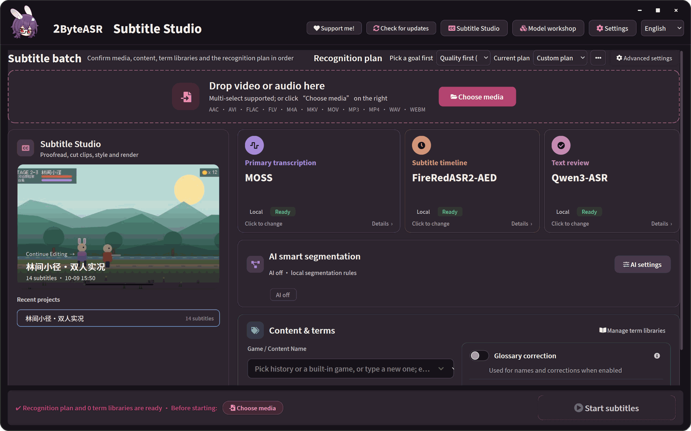
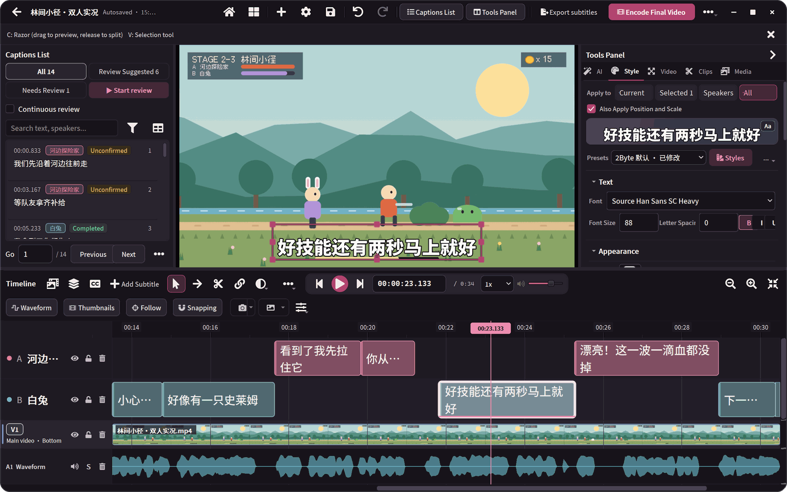
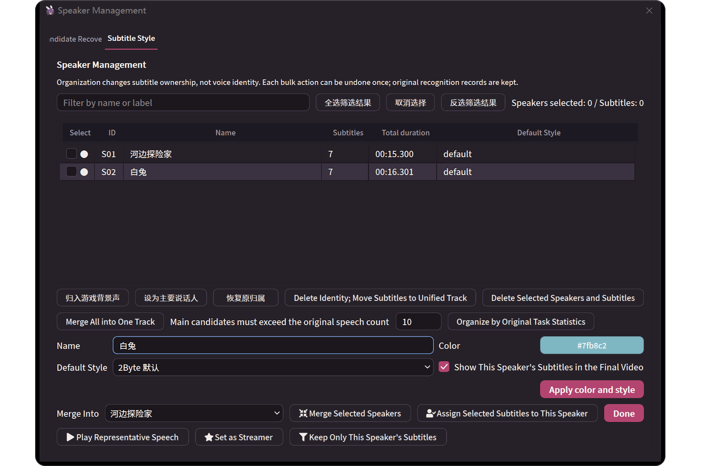
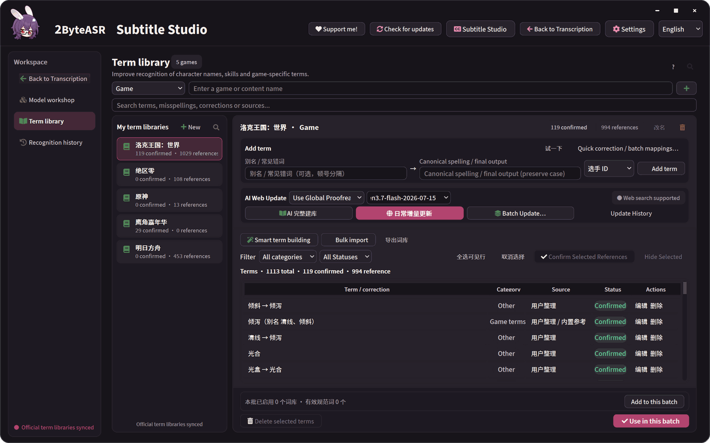
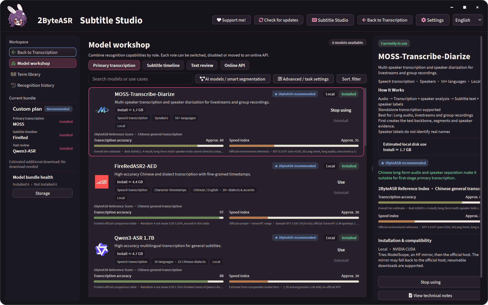

# 2ByteASR: a tour of the interface

Everything below is the real app (development build, 2026-10-09). The sample is a self-made animation with two synthetic Chinese voices, recognised locally with MOSS + FireRedASR2-AED + Qwen3-ASR. How the assets were made is described in the [asset notes](assets/readme/README.md) (Chinese). Clips without "English UI" in the caption show the Chinese interface.

## Home and recognition

Home (English UI): drop in media, choose primary transcription, subtitle timeline and text review, then click "Start subtitles".

Progress: the current step, the time and result of each step, and the full run log.

Completion: subtitle count, elapsed time, items to check and a full preview.

## Subtitle Studio

Studio (English UI): captions list, video preview, style panel and a timeline with one track per speaker.

Razor: drag to preview both halves and release to cut; cuts land on word boundaries.

Review: versions from different models side by side with the differences highlighted; click to adopt.

Speaker manager (English UI): names, colours and default styles.

## Export

Cut from the MP4 the app actually exported.

Encode finished (the local output path is masked).

## Terms, models and themes

Term library (English UI): terms, misrecognitions, sources and confirmation status per game.

Model workshop (English UI): models per role with size, runtime and reference scores.

Five UI themes: Deep Grape / Burgundy, Warm Cream / Green, Warm Night / Cream, Lavender Workspace and Slate / Editorial.

[Back to the overview](../README_EN.md) · [User guide](product-guide.en.md)
