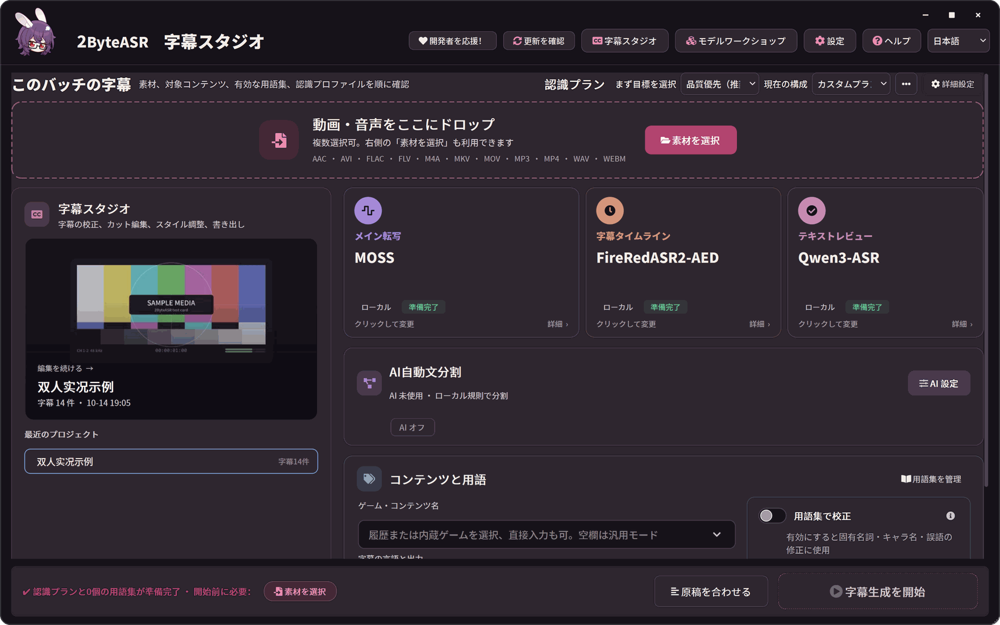
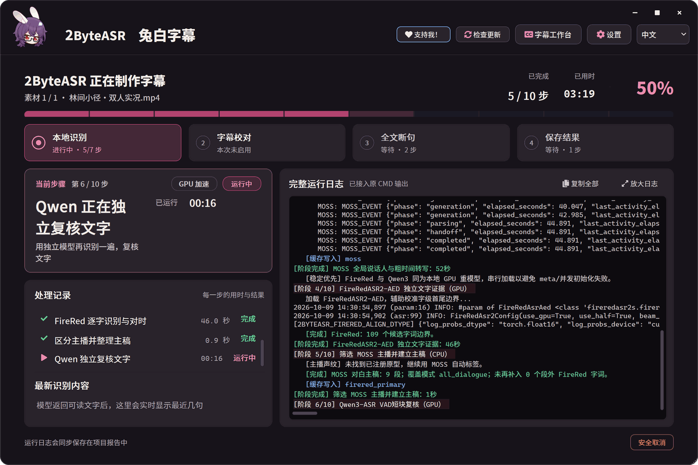
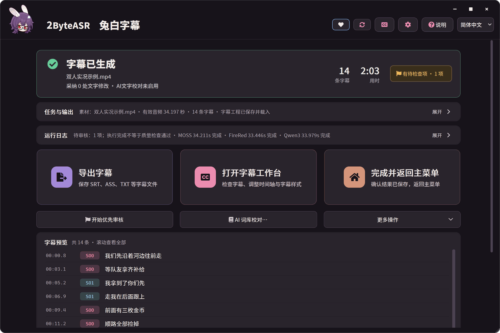
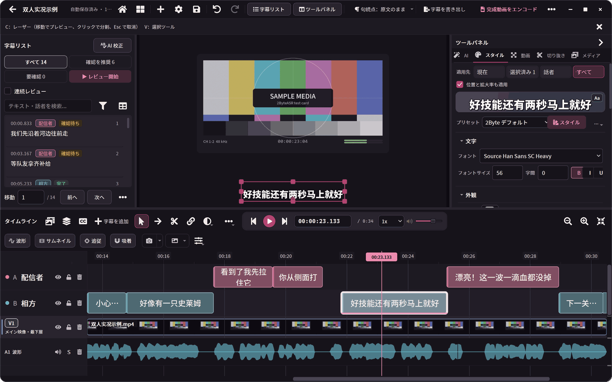
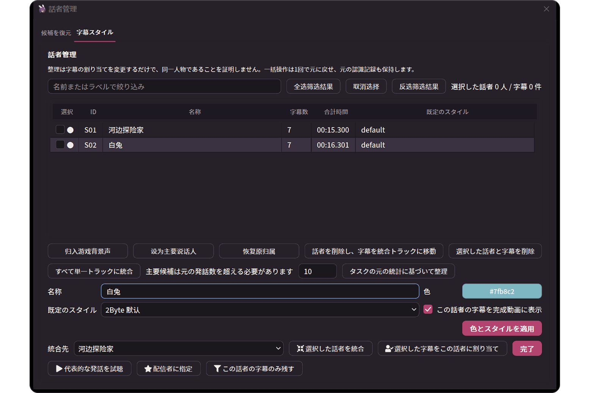
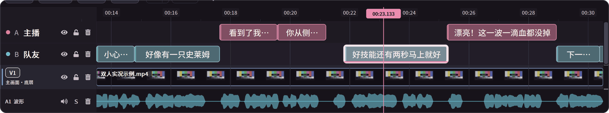
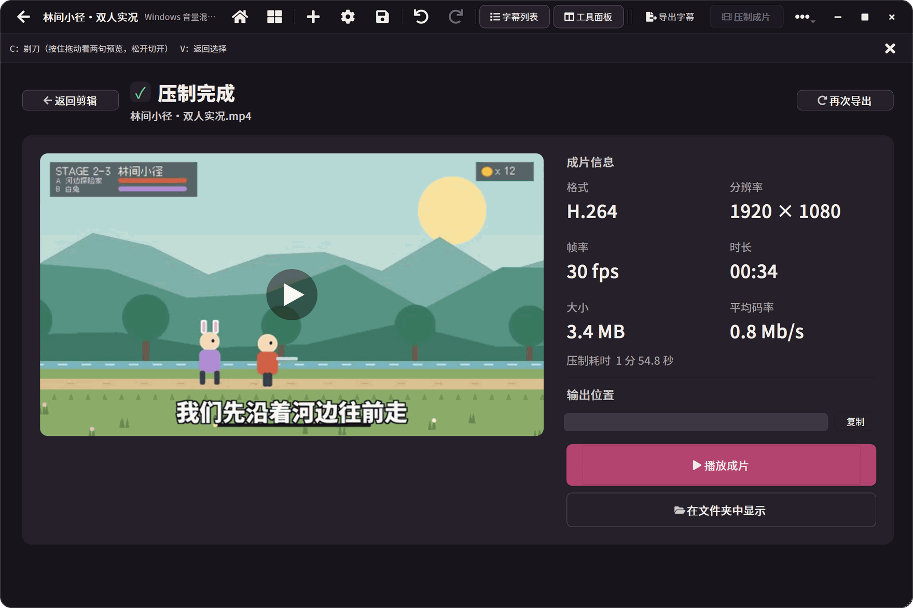
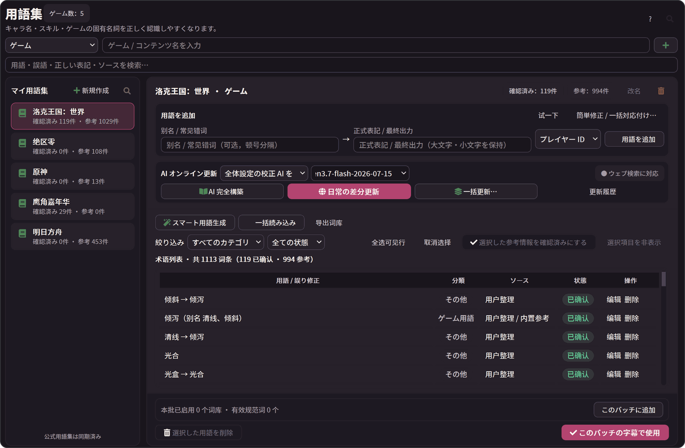
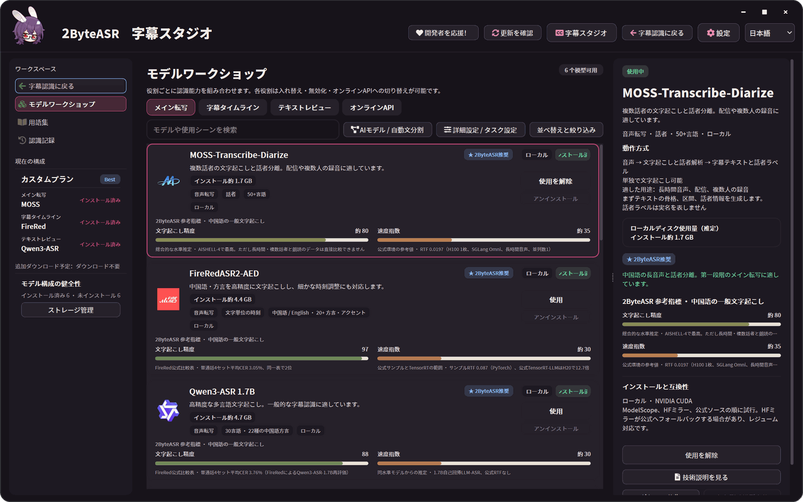
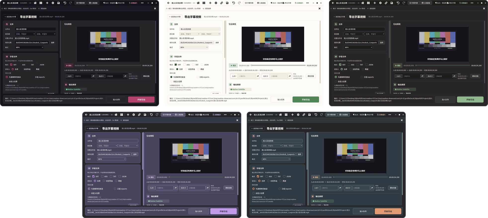

# 2ByteASR：画面ツアー

以下はすべて実際のアプリ画面です（2026-10-09 開発版）。サンプルは自作アニメーションと合成音声による中国語の 2 人の会話で、ローカルの MOSS + FireRedASR2-AED + Qwen3-ASR で認識しました。素材の作り方は[素材について](assets/readme/README.md)（中国語）を参照してください。説明に「日本語 UI」とない画像は中国語 UI です。

## ホームと認識

ホーム（日本語 UI）：素材をドロップし、メイン転写・字幕タイムライン・テキストレビューを選んで「字幕生成を開始」を押します。

進捗：現在のステップ、各ステップの所要時間と結果、実行ログ。

完了：字幕数、所要時間、確認が必要な項目、全字幕のプレビュー。

## 字幕スタジオ

スタジオ（日本語 UI）：字幕リスト、動画プレビュー、スタイルパネル、話者ごとのトラックを持つタイムライン。

話者管理（日本語 UI）：名前・色・既定スタイル。

話者トラック：話者ごとの字幕が自動でそれぞれのトラックに入ります。

## 書き出し

焼き込み完了画面（ローカル出力パスは隠しています）。

## 用語・モデル・テーマ

用語集（日本語 UI）：ゲームごとの用語、誤認識、出典、確認状態。

モデルワークショップ（日本語 UI）：役割ごとのモデル、サイズ、実行方式、参考指数。

5 つの UI テーマ：ディープグレープ / ワイン、ウォームクリーム / グリーン、ウォームナイト / クリーム、ラベンダー・ワークスペース、スレート / エディトリアル。

[概要に戻る](../README_JA.md) · [利用ガイド](product-guide.ja.md)
